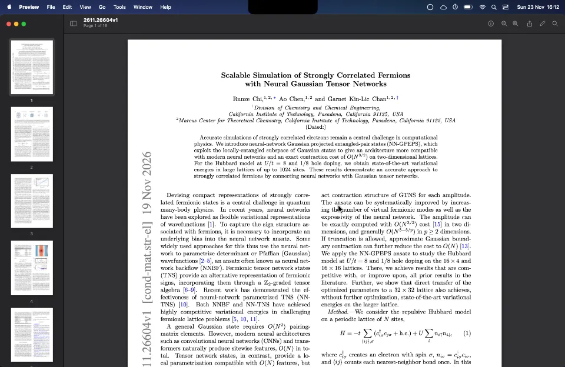

# blink



A tiny dot in your Mac's menu bar that tells you when Claude Code sessions are done and takes you to them. It's a ~440 KB native app. It uses no CPU while idle: nothing polls. 

---
Requires macOS 13+, the Xcode Command Line Tools (`xcode-select --install`),
`jq` (bundled with macOS 15+), and Claude Code.

```sh
git clone https://github.com/yashpincha/blink ~/blink
~/blink/build/install.sh
```

I swear the file never actually "runs" anything. I found the permissioning a bit odd but what do you do! To update, run `git pull && build/install.sh`. To remove everything, run
`build/uninstall.sh` (`--keep-cert` keeps the signing certificate). Needless to say everything stays on your Mac. blink makes no network calls and keeps no logs. Tear it apart and find out if you'd like. The panel is excluded from screen sharing and recordings (where macOS honors that). Below's how to develop :)

```sh
build/build.sh          # build/blink.app
build/build.sh test     # unit tests (ancillary/tests.swift) and hook tests (ancillary/hook_test.sh)
build/build.sh vsix     # build/blink.vsix
```

## License

MIT
